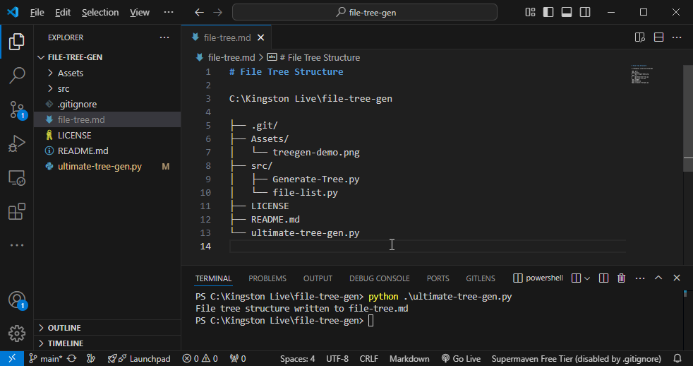

# File Tree Generator

A (customizable) python script for generating file trees in Markdown format.



## Features

- **Customizable Exclusion**: Easily configure directories to exclude from the file tree, with options to exclude entire directories or only sub-directories.
- **Dynamic Path Generation**: It knows your project's root directory and crawls the directory tree to generate paths and sub-paths dynamically.
- **Markdown Output**: Outputs a neatly formatted Markdown file representing the project structure.
- **Cross-Platform Compatibility**: Works on any operating device that supports python.

<!-- - Generates a visual representation of the directory structure.
- Excludes specified directories. -->

## Requirements

- Python 3.x

## Usage

1. Clone the repository:

   ```bash
   git clone https://github.com/kingstondoesit/file-tree-gen.git
   ```

2. Navigate to the project directory:

   ``` bash
   cd file-tree-gen
   ```

3. Run the script:

   ``` python
   # Scan the current working directory
   python ultimate-tree-gen.py

   # Scan a specific directory by relative path
   python ultimate-tree-gen.py "./<a subfolder>"
   python ultimate-tree-gen.py "../<a parent folder>"

   # Scan a specific directory by absolute path
   python ultimate-tree-gen.py "C:\path\to\project"
   ```

4. The script generates a Markdown file `file-tree_<project-folder-name>.md` in the root directory with the path location and a hierachical representation of its content(s).

## Customizable Options

- `excluded_dirs`: Specify directories to exclude from the file tree generation process. Default directory = `"node_modules"`. Separate multiple directories with commas.
- `exclude_entire_dirs`: Default value is `False`. Set to `True` to exclude directories entirely from the file tree render, instead of just their subdirectories.

Excluded names are matched as complete directory names at any depth in the project, whether the project root is supplied as a command-line argument or defaults to the current directory.

For example:

   ``` python
   # Define directories to exclude (Automatically excludes their sub-directories)
   excluded_dirs = ["node_modules", ".git", ".venv"]

   # Set exclusion mode
   exclude_entire_dirs = True  
   ```

The above configuration in [ultimate-tree-gen.py](./ultimate-tree-gen.py) will exclude the `node_modules`, `.git` and `.venv` directories entirely from the file tree.

## Contributing

Contributions are welcome! If you find a bug or have a suggestion for improvement, please open an issue or submit a pull request on the repository.

1. Fork the repository.

2. Create a new branch for your changes.

   ``` bash
   git checkout -b <your-branch-name>
   ```

3. Make your changes and commit them with a commit message.

   ``` bash
   git commit -m "Added a new feature"
   ```

4. Push your changes to your forked repository

   ``` bash
   git push origin <your-branch-name>

   ```

5. Create a pull request to the main repository.

## License

This repo is licensed under the MIT License. See the [LICENSE](./LICENSE) file for details.
